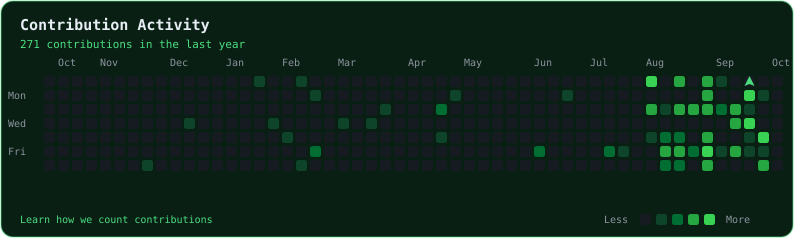

<div align="center">
  <a href="https://wagner-port.vercel.app">
    
  </a>
</div>

<div align="center">

[](https://wagner-port.vercel.app)
[](https://wa.me/5555997302586)
[](https://www.linkedin.com/in/wagner-schemmer-martins-46950627a)

</div>

```
  Sites rápidos, sistemas úteis, código limpo.
  Do front ao sensor: se resolve problema real, eu construo.
```

---

## 🎯 O que eu faço / What I do

> Construo sites e sistemas completos: landing page, dashboard, banco de dados, deploy.
> Cada projeto entra no ar de verdade — com link, README e padrão profissional.
>
> *I build complete sites and systems: landing pages, dashboards, databases, deploys.
> Every project ships for real — with a live link, a README and a professional standard.*

| 01 · DESENHAR | 02 · CODAR | 03 · CONECTAR | 04 · PUBLICAR | 05 · ITERAR |
|:---:|:---:|:---:|:---:|:---:|
| Layout e copy | HTML, CSS, JS, Python | APIs, Supabase, MQTT | Vercel, domínio, SSL | Métrica vira melhoria |
| *Design* | *Code* | *Connect* | *Ship* | *Improve* |

---

## 🚧 O que estou construindo / What I'm building

[](https://wagner-port.vercel.app)
[](https://databov-v2.vercel.app)
[](https://sentinela-cyber.vercel.app)
[](https://barbara-matematica.vercel.app)

| Projeto / Project | Ao vivo / Live | O que é / What |
|:---|:---:|:---|
| 🖥️ **Portfólio** | [wagner-port.vercel.app](https://wagner-port.vercel.app) | Vitrine neobrutalista com todos os projetos |
| 🐄 **DataBov v2** | [databov-v2.vercel.app](https://databov-v2.vercel.app) | Landing + dashboard realtime + ROI + coleira 3D |
| 🛡️ **Sentinela Cyber** | [sentinela-cyber.vercel.app](https://sentinela-cyber.vercel.app) | Força de senha + anti-phishing, 100% no navegador |
| 🧮 **Bárbara Matemática** | [barbara-matematica.vercel.app](https://barbara-matematica.vercel.app) | Aulas particulares + mural realtime de depoimentos |
| 🗓️ **Kit do Dia** | [kit-do-dia.vercel.app](https://kit-do-dia.vercel.app) | Pomodoro, tarefas, conversores e notas |
| 📡 **Backend IoT** | firmware no repo | ESP8266 + sensores → MQTT/Supabase |

---

## 🧰 Arsenal tecnológico / Tech arsenal

<div align="center">
  
</div>

---

## 📡 Sinal / Signal

<div align="center">
  
  
</div>

## 📅 O ano, até aqui / The year, so far

<div align="center">
  
  <br><em>Um jato percorre o ano e atira nos dias mais ativos. / A jet flies the length of the year and fires at the busiest days.</em>
</div>

---

## 📫 Contato / Contact

<div align="center">

[](https://wa.me/5555997302586?text=Ol%C3%A1!%20Vi%20seu%20GitHub%20e%20quero%20conversar.)
[](https://www.linkedin.com/in/wagner-schemmer-martins-46950627a)
[](https://wagner-port.vercel.app)

🎓 Instituto Federal Farroupilha — Campus Frederico Westphalen

</div>


